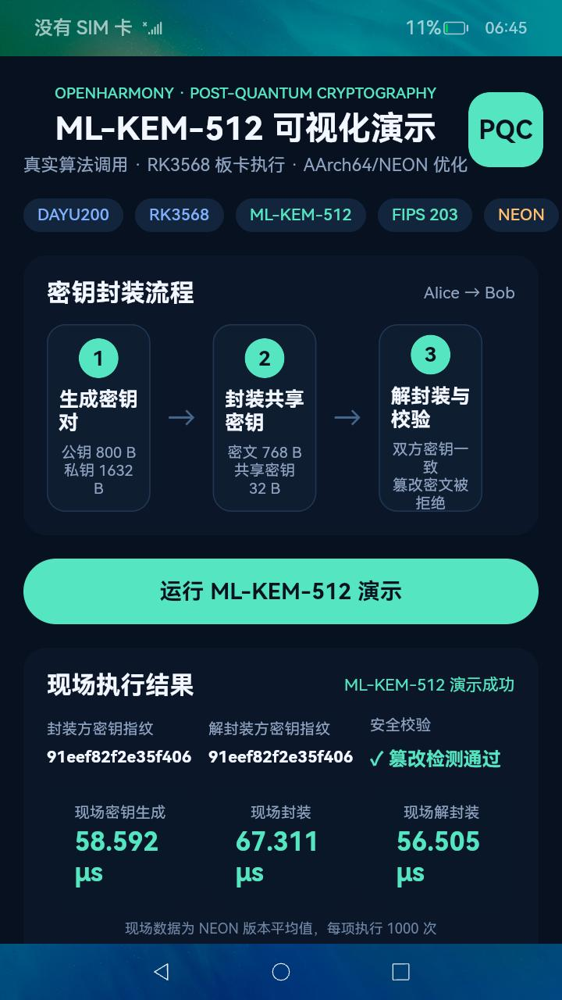
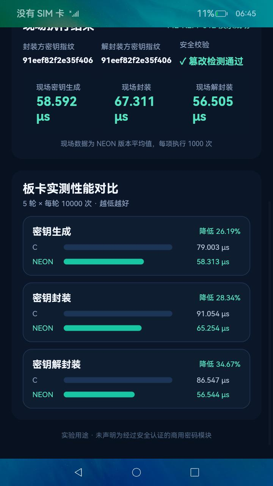

# OpenHarmony ML-KEM-512 实现与优化

面向润和 DAYU200（RK3568/AArch64）的毕业设计实验仓库。项目在 OpenHarmony 4.0 Beta2
上集成 ML-KEM-512，提供可移植 C 基线、AArch64/NEON 优化版本、正确性测试、性能测试，
以及可在板卡上现场输入消息并展示加密/解密结果的 ArkUI 应用。

## 我们完成了什么

| 工作内容 | 具体实现 | 对应文件 |
| --- | --- | --- |
| 算法移植 | 将固定版本的 ML-KEM-512 核心接入 OpenHarmony GN 构建系统 | `BUILD.gn`、`bundle.json`、`upstream/` |
| 系统适配 | 使用 `/dev/urandom` 为 ML-KEM 提供系统随机数，并处理错误和短读 | `src/randombytes_ohos.c` |
| 正确性验证 | 测试密钥生成、封装、解封装、共享密钥一致性、密文篡改和私钥破坏 | `src/mlkem_selftest.c` |
| 消息演示 | 在 ML-KEM 协商的共享密钥上实现教学用 KEM-DEM 消息加密、解密和完整性校验 | `src/mlkem_hybrid.h`、`src/mlkem_hybrid_selftest.c` |
| 性能实验 | 在同一流程下测量密钥生成、封装和解封装的耗时与吞吐率，输出 CSV | `src/mlkem_benchmark.c`、`results/` |
| AArch64 优化接入 | 启用上游 AArch64 汇编后端，并与可移植 C 版本进行同板卡配对测试 | `BUILD.gn`、`upstream/src/native/aarch64/` |
| 可视化应用 | 使用 ArkUI 和 N-API 调用原生算法，支持现场输入消息并展示明文、密文、解密结果和性能对比 | `ui/` |

本项目没有声称从零原创 ML-KEM 数学算法或上游 AArch64 汇编。我们的主要工作是算法选型、
OpenHarmony/RK3568 移植、双实现构建、系统随机数和 N-API 适配、可视化演示、测试设计、
实机性能测量与结果分析。

## 系统结构与演示流程

```text
ArkUI 可视化页面
        │ 用户输入消息、触发测试、展示结果
        ▼
OpenHarmony N-API 原生桥接
        ├───────────────┐
        ▼               ▼
可移植 C 实现      AArch64/NEON 实现
        └───────┬───────┘
                ▼
       ML-KEM-512 / SHAKE256 / SHA3-256
                ▼
     DAYU200 实机结果与 CSV 性能数据
```

一次消息演示包含以下步骤：

1. 接收用户输入的 UTF-8 明文；
2. 生成 ML-KEM-512 密钥对，并封装得到 KEM 密文和发送方共享密钥；
3. 接收方解封装得到共享密钥，并校验双方密钥指纹是否一致；
4. 由共享密钥和随机 Nonce 经 SHAKE256 生成密钥流，与明文异或得到消息密文；
5. 使用 SHA3-256 标签校验消息完整性，解密后展示还原明文；
6. 对可移植 C 和 AArch64/NEON 两种实现进行现场重复测试并显示平均耗时。

## 项目范围与代码来源

本仓库只保留完成本课题所需的代码和实验材料，不包含原 OpenHarmony 源码树，也不包含
旧工程中的 SM9、Dilithium/ML-DSA 等学长项目。

- `src/`、`ui/`、`BUILD.gn`、`bundle.json`、`Makefile`：本课题的 OpenHarmony 适配、
  测试、性能测量、KEM-DEM 演示和可视化界面。
- `upstream/`：第三方密码核心
  [pq-code-package/mlkem-native](https://github.com/pq-code-package/mlkem-native)，固定于提交
  [`b9550181de754f798941b8a4f495f8a9b8b5e3ec`](https://github.com/pq-code-package/mlkem-native/commit/b9550181de754f798941b8a4f495f8a9b8b5e3ec)。
- `results/`：2026-10-21 在同一块 DAYU200 上获得的 CSV 原始数据、汇总和最终界面截图。

第三方代码保留了原文件中的版权声明和 SPDX 标识。详细信息见
[`THIRD_PARTY_NOTICES.md`](THIRD_PARTY_NOTICES.md) 和
[`upstream/LICENSE.mlkem-native`](upstream/LICENSE.mlkem-native)。

## 功能

- ML-KEM-512 密钥生成、封装和解封装；
- 密钥、密文篡改及隐式拒绝测试；
- 可移植 C 与 AArch64/NEON 的同条件性能对比；
- ArkUI 手动输入消息、加密、密文展示、解密和完整性校验；
- 板卡现场重新测试并展示两种实现的耗时和加速效果。

ML-KEM 是密钥封装机制，不能直接加密任意长度消息。界面演示采用教学用 KEM-DEM：
ML-KEM 协商 32 字节共享密钥，SHAKE256 生成消息密钥流，SHA3-256 标签校验完整性。
该组合用于毕业设计实验，不应声明为经过安全认证的商用密码模块。

## 实验结果

DAYU200 上进行了 5 轮配对测试，每个操作每轮执行 10000 次，并交替两种实现的运行顺序。

| 操作 | 可移植 C（μs） | AArch64/NEON（μs） | 耗时降低 | 加速比 |
| --- | ---: | ---: | ---: | ---: |
| 密钥生成 | 79.003 | 58.313 | 26.19% | 1.355x |
| 密钥封装 | 91.054 | 65.254 | 28.34% | 1.395x |
| 密钥解封装 | 86.547 | 56.544 | 34.67% | 1.531x |

原始的 30 行测量记录和统计汇总分别位于：

- `results/dayu200_mlkem512_comparison_20261021.csv`
- `results/dayu200_mlkem512_summary_20261021.csv`

结果表明，在本次 DAYU200 实验环境中，AArch64/NEON 版本的三个核心操作均快于可移植 C
基线，其中解封装的耗时降低最多，为 34.67%，对应 1.531 倍加速。该结论只针对本仓库记录的
板卡、系统版本、编译参数和测试方法，不直接推广到其他硬件环境。

## 成果展示

### 手动输入、加密、解密与完整性校验

<p align="center">
  
</p>

界面会同时显示输入明文、消息密文、ML-KEM 密文摘要、Nonce、认证标签、双方共享密钥
指纹、解密明文以及一致性校验结果。加密前的完整截图见
[`dayu200_pqc_ui_final_before_20261021.jpeg`](results/dayu200_pqc_ui_final_before_20261021.jpeg)。

### 可移植 C 与 AArch64/NEON 实机对比

<p align="center">
  
</p>

界面中的数据来自板卡现场执行，而不是写死的展示文本；点击“重新现场测试”可以再次调用
两种原生实现并刷新三项平均耗时和耗时降低比例。

## 目录

```text
.
├── BUILD.gn                    OpenHarmony GN 构建规则
├── bundle.json                 OpenHarmony 部件描述
├── Makefile                    Linux 主机快速测试
├── src/                        适配、自测、基准与 KEM-DEM 逻辑
├── ui/                         ArkUI 页面、资源与 N-API 桥接
├── upstream/                   固定版本 mlkem-native 及 AArch64 后端
├── results/                    DAYU200 实测数据和截图
└── docs/                       OpenHarmony 接入说明
```

## 主机快速验证

Linux 主机需安装 C 编译器和 `make`：

```sh
make test
make benchmark
```

`make test` 会执行 ML-KEM 正反例测试，以及包含中文 UTF-8 明文的 KEM-DEM 加解密与
密文篡改拒绝测试。构建文件输出到被 Git 忽略的 `build/`。

## 集成到 OpenHarmony

在 OpenHarmony 4.0 Beta2 源码根目录执行：

```sh
git clone https://github.com/Hayd-coder/openharmony-pqc-mlkem.git pqc_mlkem
```

随后按 [`docs/OPENHARMONY_INTEGRATION.md`](docs/OPENHARMONY_INTEGRATION.md) 将部件加入
`build/subsystem_config.json` 和 `vendor/hihope/rk3568/config.json`，再编译：

```sh
./build.sh --product-name rk3568 --build-target pqc_mlkem
```

HAP 输出位置：

```text
out/rk3568/obj/pqc_mlkem/PqcMlkemDemo.hap
```

连接 DAYU200 的 USB 3.0 OTG 口后安装并启动：

```sh
HDC=out/sdk/ohos-sdk/linux/toolchains/hdc
$HDC install -r out/rk3568/obj/pqc_mlkem/PqcMlkemDemo.hap
$HDC shell aa start -a EntryAbility -b com.example.pqcmlkem
```

## 许可证

本课题新增代码采用 [Apache License 2.0](LICENSE)。`upstream/` 中的第三方文件仍适用
各文件标注的许可证；本仓库按 mlkem-native 提供的许可选项以 Apache-2.0 使用其核心代码。
