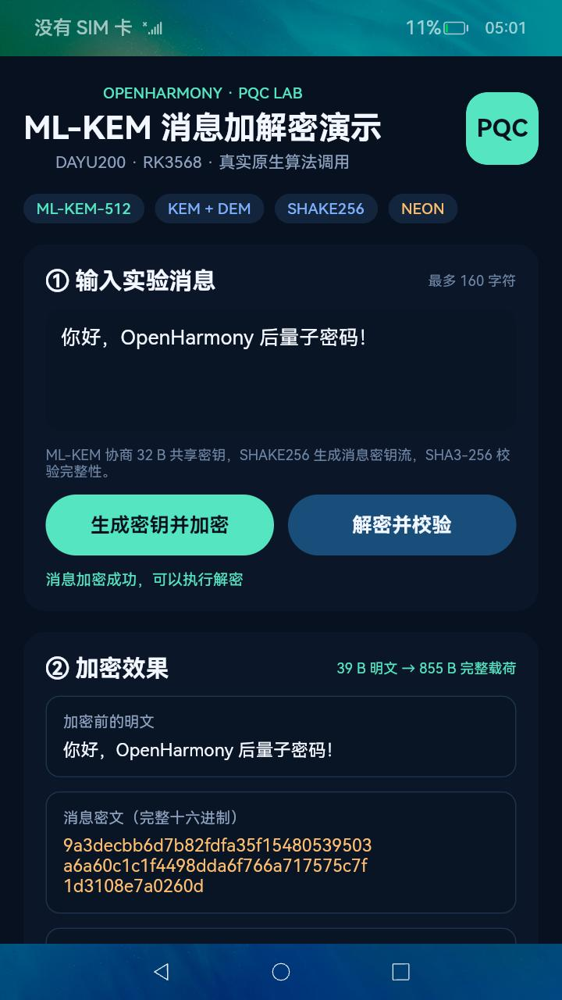
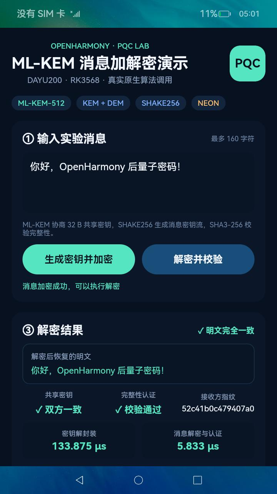
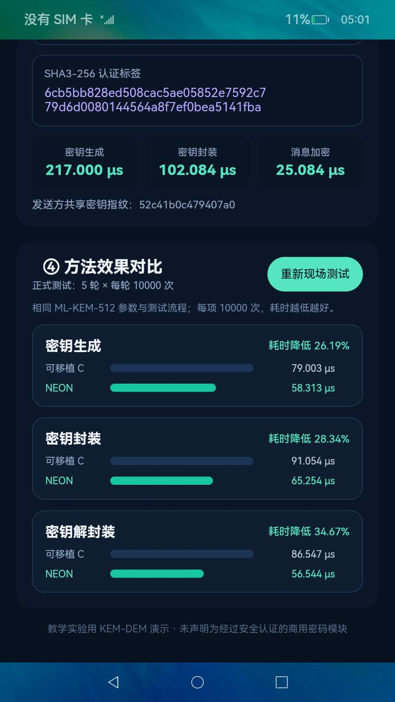

# 基于 OpenHarmony 的 ML-KEM-512 实现与优化

这是一个面向润和 DAYU200（RK3568）的毕业设计项目。项目把 ML-KEM-512 接入
OpenHarmony 4.0 Beta2，在板卡上完成正确性测试、消息加解密演示，以及可移植 C 和
AArch64/NEON 两种实现的性能对比。

界面不是预先写好的动画或模拟数据。密钥生成、封装、解封装、消息加密和现场性能测试
都通过 N-API 调用板卡上的原生 C 代码执行。

## 开发环境

| 项目 | 使用环境 |
| --- | --- |
| 开发板 | 润和 HH-SCDAYU200 |
| 处理器 | Rockchip RK3568，四核 Cortex-A55，AArch64 |
| 操作系统 | OpenHarmony 4.0 Beta2（标准系统） |
| 算法 | ML-KEM-512（FIPS 203） |
| 界面 | ArkUI Stage 模型 |
| 原生接口 | OpenHarmony N-API |
| 对比实现 | 可移植 C、AArch64/NEON |

## 项目完成的内容

项目的工作主要分为以下几部分：

1. 将 ML-KEM-512 加入 OpenHarmony 的 GN 构建系统，生成板卡测试程序、原生动态库和 HAP；
2. 使用 `/dev/urandom` 实现 OpenHarmony/Linux 下的随机数适配；
3. 编写正确性测试，覆盖密钥生成、封装、解封装、共享密钥一致性、密文篡改和私钥破坏；
4. 在同一个构建目标中保留可移植 C 和 AArch64/NEON 两种实现，使用相同参数和流程测试；
5. 编写 ArkUI 演示程序，允许现场输入消息，并显示明文、密文、Nonce、认证标签和解密结果；
6. 在 DAYU200 上完成多轮实测，保存原始 CSV、统计结果和板卡截图。

OpenHarmony/RK3568 接入、双版本构建、随机数和 N-API 适配、测试程序、演示界面、
说明文档、实机测试及结果分析均在本项目中完成。

## 板卡演示

程序启动后，可以修改输入框中的消息。点击“生成密钥并加密”后，板卡会生成 ML-KEM
密钥对、协商共享密钥并生成消息密文；点击“解密并校验”后，界面显示恢复的明文和校验结果。

| 手动输入并生成密文 | 解密与完整性校验 |
| :---: | :---: |
|  |  |

截图中的消息是“你好，OpenHarmony 后量子密码！”。本次运行中，39 字节 UTF-8 明文生成了
855 字节完整载荷。解密后明文完全一致，发送方与接收方共享密钥一致，完整性认证通过。
完整的密文、ML-KEM 密文摘要、Nonce 和 SHA3-256 标签见
[`dayu200_manual_ciphertext_20261023.jpeg`](results/dayu200_manual_ciphertext_20261023.jpeg)。

性能对比页面使用项目保存的正式测试结果，也可以点击“重新现场测试”，在当前板卡上重新
调用两种实现并刷新数据。

<p align="center">
  
</p>

## 消息加解密方式

ML-KEM 本身是密钥封装机制，不能直接加密任意长度的文本。演示程序采用简单的教学用
KEM-DEM 流程：

```text
ML-KEM 密钥生成
       │
       ├─ 封装 ──> KEM 密文 + 发送方共享密钥
       │                         │
       └─ 解封装 <─ KEM 密文 ── 接收方共享密钥
                                 │
共享密钥 + Nonce ── SHAKE256 ──> 消息密钥流
                                 │
明文 ─────────────── XOR ───────> 消息密文
                                 │
共享密钥 + Nonce + 密文 ─ SHA3-256 ─> 完整性标签
```

解密端先用 ML-KEM 解封装得到共享密钥，再恢复消息并验证标签。该 KEM-DEM 组合属于本项目
的消息演示流程，不改变 ML-KEM-512 本身的密钥封装接口。

## DAYU200 测试结果

正式测试共 5 轮，每轮对密钥生成、封装和解封装各执行 10000 次。两种实现交替运行，避免
固定先后顺序对结果造成明显影响。表中是 5 轮平均值：

| 操作 | 可移植 C（μs） | AArch64/NEON（μs） | 耗时降低 | 加速比 |
| --- | ---: | ---: | ---: | ---: |
| 密钥生成 | 79.003 ± 0.605 | 58.313 ± 0.133 | 26.19% | 1.355x |
| 密钥封装 | 91.054 ± 0.213 | 65.254 ± 0.164 | 28.34% | 1.395x |
| 密钥解封装 | 86.547 ± 0.154 | 56.544 ± 0.047 | 34.67% | 1.531x |

在这块 DAYU200 和当前构建配置下，AArch64/NEON 版本的三个操作都快于可移植 C，
其中解封装的耗时降低最多。这个结果只对应仓库记录的硬件、系统和测试方法，不代表其他
平台也会得到完全相同的数据。

原始记录和汇总文件位于：

- [`dayu200_mlkem512_comparison_20261021.csv`](results/dayu200_mlkem512_comparison_20261021.csv)
- [`dayu200_mlkem512_summary_20261021.csv`](results/dayu200_mlkem512_summary_20261021.csv)

## 下载后能否直接运行

分三种情况：

### 1. 在普通 Linux 电脑上验证算法

只下载本仓库就可以。电脑需要有 C 编译器和 `make`：

```sh
git clone https://github.com/Hayd-coder/openharmony-pqc-mlkem.git
cd openharmony-pqc-mlkem
./scripts/verify_package.sh
make benchmark
```

`make test` 会运行 ML-KEM 正反例测试，以及中文 UTF-8 消息的加解密和篡改拒绝测试。

### 2. 不编译，直接在 DAYU200 上演示界面

从 [v1.0.2 Release](https://github.com/Hayd-coder/openharmony-pqc-mlkem/releases/tag/v1.0.2)
下载 `PqcMlkemDemo-rk3568-v1.0.2.hap`。电脑需要有 OpenHarmony `hdc`，板卡需要运行兼容的
OpenHarmony 4.0 Beta2 RK3568 系统：

```sh
hdc list targets
hdc install -r PqcMlkemDemo-rk3568-v1.0.2.hap
hdc shell aa start -a EntryAbility -b com.example.pqcmlkem
```

也可以使用仓库提供的安装脚本：

```sh
HDC_BIN=/path/to/hdc ./scripts/run_board_demo.sh PqcMlkemDemo-rk3568-v1.0.2.hap
```

更完整的现场操作见 [`docs/DEMO_GUIDE.md`](docs/DEMO_GUIDE.md)。

### 3. 从源码重新编译 HAP

仅有本仓库还不够，因为 ArkUI、N-API 和交叉编译工具属于 OpenHarmony 源码环境。需要先准备
OpenHarmony 4.0 Beta2 源码，再把本仓库克隆到源码根目录下的 `pqc_mlkem/`：

```sh
cd /path/to/OpenHarmony
git clone https://github.com/Hayd-coder/openharmony-pqc-mlkem.git pqc_mlkem
```

然后按 [`docs/OPENHARMONY_INTEGRATION.md`](docs/OPENHARMONY_INTEGRATION.md) 注册子系统和
RK3568 部件，执行：

```sh
./build.sh --product-name rk3568 --build-target pqc_mlkem
```

生成的应用位于：

```text
out/rk3568/obj/pqc_mlkem/PqcMlkemDemo.hap
```

仓库已经包含本项目需要的 C/ArkTS 源码、GN 配置、资源、公开签名 Profile、算法核心、
测试数据和说明文档；不包含 OpenHarmony 整套源码、编译缓存和设备固件。

## 目录说明

```text
.
├── BUILD.gn                    OpenHarmony 构建目标
├── bundle.json                 OpenHarmony 部件描述
├── Makefile                    Linux 主机测试入口
├── src/
│   ├── randombytes_ohos.c      系统随机数适配
│   ├── mlkem_selftest.c        正确性与破坏测试
│   ├── mlkem_benchmark.c       CSV 性能测试
│   ├── mlkem_hybrid.h          教学用消息加解密辅助函数
│   └── mlkem_hybrid_selftest.c 消息加解密自测
├── ui/
│   ├── entry/                  ArkUI 页面和资源
│   ├── native/                 N-API 原生桥接
│   └── signature/              OpenHarmony 公开签名 Profile
├── upstream/                   ML-KEM 核心及 AArch64 后端
├── results/                    DAYU200 数据和最终截图
├── scripts/                    完整性检查和板卡安装脚本
└── docs/                       接入与演示说明
```

## 许可证

本项目编写的 OpenHarmony 适配、测试、界面和文档采用 [Apache License 2.0](LICENSE)。
`upstream/` 保留算法源码原有的版权头和许可证，许可文本见
[`upstream/LICENSE.mlkem-native`](upstream/LICENSE.mlkem-native)。
